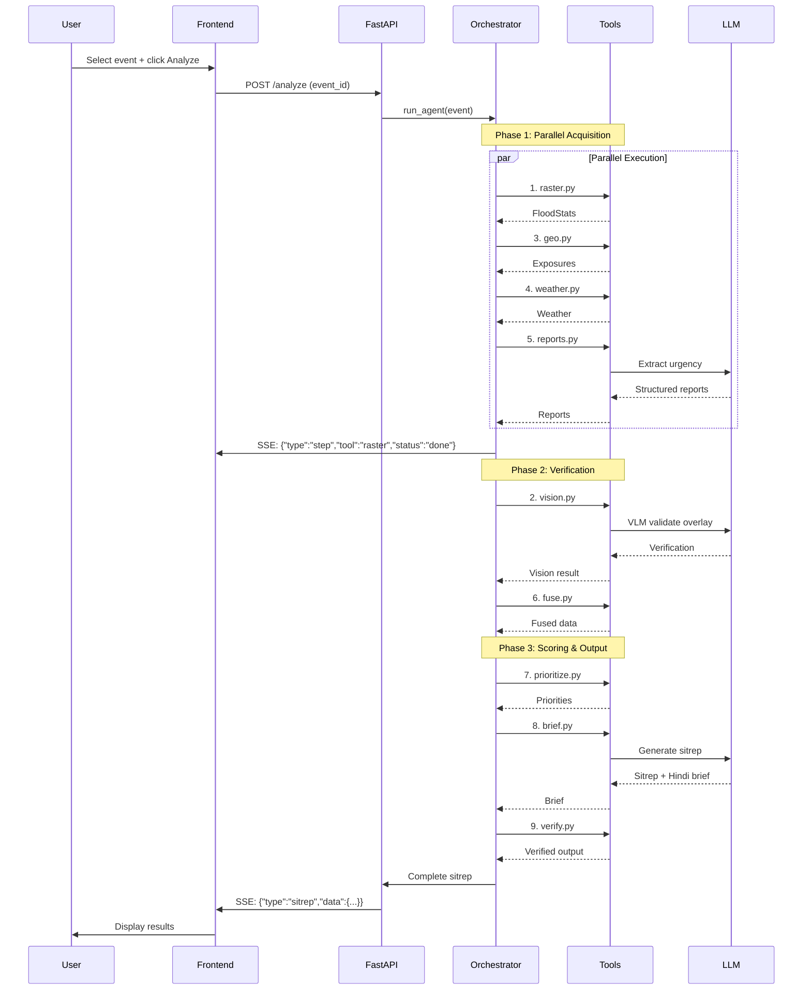

# SkyRelief Architecture

## System Overview

SkyRelief is a **multimodal AI orchestrator** that fuses satellite imagery, ground reports, weather data, and geographic information to produce actionable disaster response intelligence.

```
┌─────────────────────────────────────────────────────────────────────┐
│                         PRESENTATION LAYER                          │
├─────────────────────────────────────────────────────────────────────┤
│  Next.js 15 Frontend (TypeScript + React)                          │
│    • MapLibre GL (flood overlay + settlement markers)               │
│    • SSE client (real-time progress streaming)                      │
│    • Priority dashboard with silent-flood badges                    │
│    • Bilingual brief viewer (EN + HI)                               │
└────────────────────────────┬────────────────────────────────────────┘
                             │ HTTPS + SSE
                             ↓
┌─────────────────────────────────────────────────────────────────────┐
│                         APPLICATION LAYER                           │
├─────────────────────────────────────────────────────────────────────┤
│  FastAPI Backend (Python 3.11+)                                     │
│    • REST API endpoints (/analyze, /events, /layers)                │
│    • SSE generator (streams agent progress)                         │
│    • Orchestrator agent (9-tool pipeline)                           │
│    • LLM/VLM client wrapper (OpenAI-compatible)                     │
└────────────────────────────┬────────────────────────────────────────┘
                             │
                             ↓
┌─────────────────────────────────────────────────────────────────────┐
│                         INTELLIGENCE LAYER                          │
├─────────────────────────────────────────────────────────────────────┤
│  Agent Orchestrator (orchestrator.py)                               │
│    Phase 1: Parallel Data Acquisition                               │
│    Phase 2: Verification & Fusion                                   │
│    Phase 3: Scoring & Output Generation                             │
│                                                                     │
│  Tool Suite (agent/tools/)                                          │
│    1. raster.py       Deterministic flood detection                 │
│    2. vision.py       VLM verification                              │
│    3. geo.py          Settlement exposure analysis                  │
│    4. weather.py      Rainfall time series                          │
│    5. reports.py      Report extraction + geocoding                 │
│    6. fuse.py         Cross-validation                              │
│    7. prioritize.py   6-factor scoring                              │
│    8. brief.py        Sitrep generation                             │
│    9. verify.py       Source verification                           │
└────────────────────────────┬────────────────────────────────────────┘
                             │
                             ↓
┌─────────────────────────────────────────────────────────────────────┐
│                         DATA LAYER                                  │
├─────────────────────────────────────────────────────────────────────┤
│  File System Storage                                                │
│    • data/events/     GeoTIFF, GeoJSON, CSV, JSON                   │
│    • cache/           Tool output cache (JSON)                      │
│                                                                     │
│  External APIs (LIVE_DATA=1)                                        │
│    • Planetary Computer (Sentinel-1/2)                              │
│    • Open-Meteo (weather data)                                      │
│    • Overpass API (OpenStreetMap)                                   │
└─────────────────────────────────────────────────────────────────────┘
```

---

## Data Flow

### Typical Analysis Request



---

## Component Details

### Frontend (Next.js)

**Tech Stack:**
- **Framework:** Next.js 15 (App Router)
- **Language:** TypeScript 5.0
- **UI:** Tailwind CSS + custom components
- **Mapping:** MapLibre GL JS
- **State:** React hooks (useState, useEffect, useCallback)
- **API:** Fetch API + EventSource (SSE)

**Key Components:**

```typescript
app/
├── page.tsx              // Main page with event picker + analysis trigger
├── types.ts              // Shared TypeScript types
└── layout.tsx            // Root layout + metadata

components/
├── EventPicker.tsx       // Dropdown to select demo event
├── MapView.tsx           // MapLibre GL with flood layer + markers
├── TraceTimeline.tsx     // Live agent step progress
├── PriorityList.tsx      // Ranked settlements with badges
├── WhatsAppBrief.tsx     // Copy-to-WhatsApp button
├── ReportPanel.tsx       // Ground report list
└── LimitationsPanel.tsx  // Honest limitations disclosure
```

**State Management:**

```typescript
// Main page state
const [event, setEvent] = useState<Event | null>(null);
const [sitrep, setSitrep] = useState<Sitrep | null>(null);
const [trace, setTrace] = useState<TraceStep[]>([]);
const [isAnalyzing, setIsAnalyzing] = useState(false);

// SSE connection
const startAnalysis = async () => {
  const sse = new EventSource(`${API_URL}/analyze?event_id=${event.id}`);
  
  sse.onmessage = (e) => {
    const msg = JSON.parse(e.data);
    if (msg.type === 'step') {
      setTrace(prev => [...prev, msg]);
    } else if (msg.type === 'sitrep') {
      setSitrep(msg.data);
    }
  };
};
```

---

### Backend (FastAPI)

**Tech Stack:**
- **Framework:** FastAPI 0.111
- **Server:** Uvicorn (ASGI)
- **Validation:** Pydantic v2
- **Streaming:** sse-starlette
- **Env:** python-dotenv

**API Endpoints:**

```python
# main.py

@app.get("/health")
async def health():
    """Health check endpoint."""
    return {"status": "ok", "version": API_VERSION}

@app.get("/events")
async def list_events():
    """List available demo events."""
    return [Event.from_meta(p) for p in DATA_DIR.glob("*/meta.json")]

@app.post("/analyze")
async def analyze(request: AnalyzeRequest):
    """Run agent analysis with SSE streaming."""
    async def event_generator():
        async for msg in orchestrator.run_agent(request.event_id, request.extra_reports):
            yield {"data": json.dumps(msg)}
    
    return EventSourceResponse(event_generator())

@app.get("/layers/{event_id}/flood_mask.png")
async def get_flood_layer(event_id: str):
    """Return flood overlay PNG."""
    return FileResponse(CACHE_DIR / event_id / "flood_mask.png")

@app.get("/layers/{event_id}/settlements.geojson")
async def get_settlements(event_id: str):
    """Return settlement GeoJSON with priorities."""
    return FileResponse(CACHE_DIR / event_id / "settlements.geojson")

@app.get("/export/{event_id}.md")
async def export_sitrep(event_id: str):
    """Download markdown sitrep."""
    sitrep = load_sitrep(event_id)
    return Response(sitrep.to_markdown(), media_type="text/markdown")
```

**Pydantic Schemas:**

```python
# schemas.py

class Event(BaseModel):
    event_id: str
    name: str
    bbox: list[float]
    before_date: str
    after_date: str
    sensor: str

class FloodStats(BaseModel):
    area_km2: float
    pixel_count: int
    method: str  # "sar" | "ndwi"
    confidence: str  # "high" | "medium" | "low"

class Exposure(BaseModel):
    settlement: str
    lat: float
    lon: float
    flood_fraction: float
    facilities: list[str]
    road_flooded: bool
    silent_flooded: bool

class Priority(BaseModel):
    rank: int
    settlement: str
    score: float
    reasons: list[str]
    sources: list[str]
    recommended_action: str

class Sitrep(BaseModel):
    event: Event
    flood_stats: FloodStats
    priorities: list[Priority]
    reports: list[Report]
    brief_en: str
    brief_hi: str
```

---

### Agent Orchestrator

**Design Pattern:** Sequential pipeline with parallel stages.

```python
# orchestrator.py

async def run_agent(event_id: str, extra_reports: list[str] = None):
    """Main agent loop with SSE streaming."""
    
    event = load_event(event_id)
    
    # Phase 1: Parallel data acquisition
    yield sse_step("raster", "running")
    flood_stats = await raster.run(event)
    yield sse_step("raster", "done", f"{flood_stats.area_km2} km² flooded")
    
    # Run geo, weather, reports in parallel (if async)
    exposures = await geo.run(event, flood_stats)
    weather = await weather_tool.run(event)
    reports = await reports_tool.run(event, extra_reports)
    
    # Phase 2: Verification
    vision_result = await vision.run(event, flood_stats)
    fused = await fuse.run(event, exposures, reports, flood_stats)
    
    # Phase 3: Scoring & output
    priorities = await prioritize.run(event, fused.exposures, fused.reports, weather)
    brief = await brief_tool.run(event, priorities, flood_stats, weather)
    verified = await verify.run(brief, priorities)
    
    # Final sitrep
    sitrep = Sitrep(
        event=event,
        flood_stats=flood_stats,
        priorities=priorities,
        reports=fused.reports,
        brief_en=brief.en,
        brief_hi=brief.hi,
    )
    
    yield sse_sitrep(sitrep)
    yield sse_complete()
```

**Error Handling:**

```python
# Each tool has try/except with fallback
try:
    result = await tool.run(...)
except Exception as e:
    log.error(f"Tool {tool} failed: {e}")
    yield sse_step(tool, "error", str(e))
    # Use cached result or conservative default
    result = fallback_result()
```

---

### Tool Architecture

Each tool follows a standard interface:

```python
# Template
def run(
    event: Event,
    *dependencies,
) -> Result:
    """
    Execute tool logic.
    
    Args:
        event: Event metadata
        *dependencies: Outputs from upstream tools
        
    Returns:
        Structured result (Pydantic model)
    """
    
    # 1. Check cache
    cache_path = CACHE_DIR / event.event_id / f"{tool_name}.json"
    if cache_path.exists() and not has_live_data():
        return load_from_cache(cache_path)
    
    # 2. Execute core logic
    result = compute_result(event, *dependencies)
    
    # 3. Cache result
    cache_path.write_text(result.model_dump_json(indent=2))
    
    # 4. Log and return
    log.info(f"{tool_name}: {summary(result)}")
    return result
```

**Tool Dependencies:**

```
raster.py     → (event)
vision.py     → (event, flood_stats)
geo.py        → (event, flood_stats)
weather.py    → (event)
reports.py    → (event, extra_reports)
fuse.py       → (event, exposures, reports, flood_stats)
prioritize.py → (event, exposures, reports, weather)
brief.py      → (event, priorities, flood_stats, weather)
verify.py     → (brief, priorities)
```

---

## LLM/VLM Integration

**Client Abstraction:**

```python
# llm.py

class LLMClient:
    def __init__(self, base_url: str, api_key: str):
        self.client = OpenAI(base_url=base_url, api_key=api_key)
    
    def generate(
        self,
        prompt: str,
        system: str = None,
        model: str = LLM_MODEL,
        response_model: Type[BaseModel] = None,
    ) -> Union[str, BaseModel]:
        """Generate text or structured output."""
        
        messages = []
        if system:
            messages.append({"role": "system", "content": system})
        messages.append({"role": "user", "content": prompt})
        
        if response_model:
            # Structured output (Pydantic)
            return self.client.beta.chat.completions.parse(
                model=model,
                messages=messages,
                response_format=response_model,
            ).choices[0].message.parsed
        else:
            # Text output
            return self.client.chat.completions.create(
                model=model,
                messages=messages,
            ).choices[0].message.content
    
    def vision(
        self,
        prompt: str,
        image: Image.Image,
        model: str = VLM_MODEL,
    ) -> str:
        """Vision model inference."""
        
        # Encode image to base64
        buffered = BytesIO()
        image.save(buffered, format="PNG")
        img_b64 = base64.b64encode(buffered.getvalue()).decode()
        
        response = self.client.chat.completions.create(
            model=model,
            messages=[{
                "role": "user",
                "content": [
                    {"type": "text", "text": prompt},
                    {"type": "image_url", "image_url": {"url": f"data:image/png;base64,{img_b64}"}},
                ],
            }],
        )
        
        return response.choices[0].message.content
```

**Usage Example:**

```python
# In reports.py
from llm import LLMClient
from schemas import ExtractedReport

llm = LLMClient(LLM_BASE_URL, LLM_API_KEY)

# Structured extraction
reports = llm.generate(
    prompt=f"Extract urgency, location, need from: {raw_text}",
    response_model=list[ExtractedReport],
)

# In vision.py
verification = llm.vision(
    prompt="Does this overlay correctly show flooded areas in blue?",
    image=overlay_image,
)
```

---

## Caching Strategy

**Why Cache?**
- Avoid reprocessing identical queries
- Save LLM API costs
- Enable offline demo mode
- Faster development iteration

**Cache Structure:**

```
cache/
├── himachal_2023/
│   ├── flood_stats.json       # raster.py output
│   ├── exposures.json         # geo.py output
│   ├── weather.json           # weather.py output
│   ├── reports.json           # reports.py output
│   ├── vision.json            # vision.py output
│   ├── fused.json             # fuse.py output
│   ├── priorities.json        # prioritize.py output
│   ├── brief.json             # brief.py output
│   ├── flood_mask.png         # Raster overlay
│   └── settlements.geojson    # Priority markers
└── assam_2022/
    └── ...
```

**Cache Invalidation:**
- Manual: `rm -rf cache/{event_id}`
- Automatic: Detect `source="live_input"` in extra_reports → skip cache
- Time-based: Not implemented (all demo events are historical)

---

## Deployment Architecture

### Development

```
┌─────────────────┐          ┌─────────────────┐
│  localhost:3000 │  ──────→ │  localhost:8000 │
│  Next.js dev    │   HTTP   │  FastAPI dev    │
└─────────────────┘          └─────────────────┘
```

### Production

```
┌─────────────────┐          ┌─────────────────┐
│  Vercel         │  ──────→ │  Render/Railway │
│  (Next.js)      │   HTTPS  │  (FastAPI)      │
│  Auto CDN       │          │  Docker + Redis │
└─────────────────┘          └─────────────────┘
         │                            │
         │                            ↓
         │                   ┌─────────────────┐
         │                   │  Planetary PC   │
         └──────────────────→│  (Sentinel)     │
                 CORS         │  Open-Meteo     │
                              └─────────────────┘
```

**Deployment Steps:**

1. **Frontend (Vercel):**
   ```bash
   # From web/ directory
   vercel --prod
   # Set env: NEXT_PUBLIC_API_URL=https://api.skyrelief.com
   ```

2. **Backend (Render):**
   ```dockerfile
   # Dockerfile
   FROM python:3.11-slim
   WORKDIR /app
   COPY api/requirements.txt .
   RUN pip install -r requirements.txt
   COPY api/ .
   CMD ["uvicorn", "main:app", "--host", "0.0.0.0", "--port", "8000"]
   ```
   
   Set env vars:
   - `LLM_BASE_URL`
   - `LLM_API_KEY`
   - `LIVE_DATA=1` (for production)

---

## Security Considerations

### API Keys
- ❌ Never commit `.env` to git
- ✅ Use environment variables for all secrets
- ✅ Rotate API keys regularly

### Input Validation
- ✅ Pydantic validates all API inputs
- ✅ `event_id` restricted to `[a-z0-9_]+` pattern
- ✅ `extra_reports` sanitized (no SQL/command injection risk since file-based)

### CORS
```python
# main.py
app.add_middleware(
    CORSMiddleware,
    allow_origins=["https://skyrelief.vercel.app", "http://localhost:3000"],
    allow_methods=["GET", "POST"],
    allow_headers=["*"],
)
```

### Rate Limiting
- Not implemented (demo project)
- Production: Add Redis + slowapi

---

## Performance Optimization

### Bottlenecks

1. **Raster Processing:** 10–30s for large events
   - Mitigation: Cache, consider GPU acceleration
   
2. **LLM Calls:** 2–5s per call
   - Mitigation: Parallel where possible, cache reports
   
3. **VLM Vision:** 5–10s for overlay validation
   - Mitigation: Make optional, use stub in offline mode

### Profiling

```python
import time
import logging

log = logging.getLogger(__name__)

def profile(func):
    def wrapper(*args, **kwargs):
        start = time.time()
        result = func(*args, **kwargs)
        elapsed = time.time() - start
        log.info(f"{func.__name__} took {elapsed:.2f}s")
        return result
    return wrapper

@profile
def run(event: Event) -> FloodStats:
    # Tool logic
    ...
```

---

## Testing Strategy

### Unit Tests
```python
# tests/test_raster.py
def test_sar_flood_detection():
    event = Event(event_id="test", sensor="sentinel-1", ...)
    result = raster.run(event)
    assert result.area_km2 > 0
    assert result.method == "sar"
```

### Integration Tests
```python
# tests/test_api.py
def test_analyze_endpoint():
    response = client.post("/analyze", json={"event_id": "himachal_2023"})
    assert response.status_code == 200
    # Check SSE stream
```

### E2E Tests
```typescript
// web/e2e/workflow.spec.ts
test('complete analysis workflow', async ({ page }) => {
  await page.goto('http://localhost:3000');
  await page.selectOption('select', 'himachal_2023');
  await page.click('button:has-text("Analyze")');
  await expect(page.locator('.priority-item')).toHaveCount(10, { timeout: 60000 });
});
```

---

## Monitoring & Observability

### Logging

```python
# config.py
logging.basicConfig(
    level=logging.INFO,
    format="%(asctime)s [%(levelname)s] %(name)s: %(message)s",
)
```

### Metrics (Future)

- Request count by endpoint
- Average analysis time
- Cache hit rate
- LLM API latency
- Error rate by tool

**Recommended Stack:**
- Prometheus + Grafana
- Or: DataDog, New Relic

---

## Future Architecture Enhancements

### Phase 1: Scale
- **Async Workers:** Celery for large AOI processing
- **Database:** PostgreSQL + PostGIS for persistent storage
- **Queue:** Redis for job queue
- **CDN:** CloudFront for static assets

### Phase 2: Real-Time
- **WebSocket:** Bidirectional for live updates
- **Event Streaming:** Kafka for sensor data ingestion
- **Incremental Processing:** Update flood mask as new images arrive

### Phase 3: Distributed
- **Microservices:** Split tools into independent services
- **Container Orchestration:** Kubernetes for auto-scaling
- **Global Deployment:** Edge functions for regional latency

---

## Questions?

- **Why not use a database?** File-based is simpler for demo/MVP. Production would use PostgreSQL + PostGIS.
- **Why FastAPI?** Fast, modern, async support, excellent docs.
- **Why not use LangChain?** Too heavy for this use case. Custom orchestrator gives full control.
- **Why cache everything?** Enables offline demos, reduces costs, faster iteration.

---

**This architecture prioritizes transparency, debuggability, and reproducibility over complexity.**
